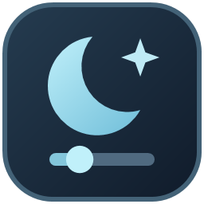

# NightDim



NightDim — бесплатная альтернатива CareUEyes для Windows 11. Настраивайте яркость, гамму и цветовую температуру каждого монитора для комфорта глаз днём и ночью.

NightDim is a free CareUEyes alternative for Windows 11. Adjust brightness, gamma and color temperature per monitor for comfortable viewing, day or night.

**[Скачать установщик / Download installer](https://github.com/dFAiDGAAS529-source/NightDim/releases/download/v1.1.2/NightDim-Setup-1.1.2-win-x64.exe)** · [Все релизы / All releases](https://github.com/dFAiDGAAS529-source/NightDim/releases)

Установщик работает для текущего пользователя. В главном окне переключатель **EN / RU** меняет язык сразу. Чтобы NightDim запускался в трее после входа в Windows, включите «Запускать с Windows» в настройках. Параметры хранятся локально.

## Запуск

1. После установки откройте NightDim через меню «Пуск». При сборке из исходников запускайте `artifacts/NightDim-win-x64/NightDim.exe` вместе с остальными файлами публикации.
2. Выберите монитор и начните с «День» или нажмите «Сбросить» для нейтрального режима. Уровень 100% убирает дополнительное затемнение. «Сбросить» также возвращает нейтральные цветовые параметры.
3. Перед первой проверкой диапазона 1–10% найдите в окне зарегистрированную аварийную комбинацию. При снижении до нового минимума NightDim даёт 15 секунд на подтверждение. «Вернуть яркость», Esc или истечение времени возвращают предыдущие настройки.
4. Закрытие окна сворачивает приложение в трей. Меню трея содержит команды открытия, отключения эффекта, аварийного восстановления и выхода.

| Комбинация по умолчанию | Действие |
| --- | --- |
| Ctrl+Alt+F10 | Аварийно отключить эффекты на всех мониторах |
| Ctrl+Alt+F9 | Переключить эффекты |
| Ctrl+Alt+PgUp / PgDn | Изменить яркость выбранного монитора на 1% |

Если Ctrl+Alt+F10 недоступна, приложение пробует Ctrl+Shift+F10. Зарегистрированные клавиши указаны в настройках и в подсказке переключателя «ВКЛ / ВЫКЛ». При недоступности обеих аварийных комбинаций NightDim блокирует диапазон 1–10%.

У яркости шаг 1%. Когда ползунок в фокусе, используйте стрелки или колёсико мыши. Гамма, ослабление синего и RGB находятся в разделе «Тонкая настройка».

Ручное изменение параметра подсвечивает «Свой». Чтобы сохранить текущие значения, откройте настройки кнопкой с шестерёнкой, выберите профиль для записи и нажмите «Сохранить». При синхронизации NightDim начинает с параметров выбранного экрана. При отключении синхронизации возвращаются индивидуальные параметры.

## Механизмы и восстановление

- **Gamma** — Windows вернула ожидаемую LUT при контрольном чтении. NightDim объединяет яркость, гамму и цветовые параметры в одну кривую на основе исходной LUT дисплея.
- **Overlay** — яркость регулирует чёрный полупрозрачный слой. Этот режим доступен на выходах с HDR и неподдерживаемой LUT. Положение слоя совпадает с прямоугольником рабочего стола в физических пикселях.
- **Hybrid** — LUT задаёт цвет и часть затемнения, overlay добавляет оставшееся затемнение. Уровни ползунка относительные. Читаемость, физическая светимость и работа поверх полноэкранного видео зависят от конвейера дисплея.

На выходах в режиме Overlay доступны настройки яркости. Цветовые преобразования требуют подходящего SDR-выхода и поддержки LUT. Night Light, ICC-профили и другие программы могут изменить LUT. Если контрольное чтение обнаружит чужую кривую, NightDim прекратит её перезапись до сброса или переключения эффекта. Начиная с 1.1.2 окно затемнения доступно для захвата. При записи всего дисплея эффект может попасть в кадр.

Если скачки яркости при смене вкладок или во время видео исчезают после выхода из NightDim, попробуйте **Настройки → Без экранного слоя**. На совместимом SDR-мониторе этот режим использует только гамма-кривую с диапазоном 43–100%. Для более глубокого затемнения снова включите экранный слой. Сохранённые значения ниже 43% доступны после смены режима.

**Фиксированное затемнение** использует слой с постоянной непрозрачностью и приостанавливает цветокоррекцию NightDim. Этот режим помогает отдельно проверить влияние гамма-кривой.

Если яркость меняется и после выхода из NightDim через трей, сравните один и тот же серый участок рядом с браузером при переключении вкладок. На встроенном дисплее проверьте **Параметры → Система → Дисплей → Яркость → Изменение яркости на основе содержимого**. На внешнем мониторе проверьте динамический контраст и энергосбережение в его меню. Доступность параметров зависит от оборудования. [Яркость в Windows 11](https://support.microsoft.com/ru-ru/windows/hardware/display-graphics/change-display-brightness-and-color-in-windows) · [Динамическая яркость на мониторах LG](https://www.lg.com/us/support/help-library/lg-monitor-brightness-levels-changing-automatically-CT32003207-20153231419459)

NightDim убирает overlay при выходе и пытается вернуть исходную LUT, только если текущая кривая всё ещё принадлежит NightDim. При аварийном завершении окна уничтожает Windows. Сохранённый журнал позволяет попробовать восстановить LUT при следующем запуске на том же выходе. Перезапуск с сохранённым экстремальным уровнем начинается с отключёнными эффектами. Основные файлы находятся в `%LOCALAPPDATA%\NightDim`.

## Сборка

Нужны Windows x64 и .NET 10 SDK. Публикация содержит рантайм .NET и WPF.

```powershell
dotnet build NightDim.slnx -c Release -m:1
dotnet run --project tests/NightDim.Tests -c Release
dotnet publish src/NightDim/NightDim.csproj -c Release -r win-x64 --self-contained true -o artifacts/NightDim-win-x64
```

Для сборки установщика см. [инструкцию Inno Setup](installer/README.md).

`--data-dir <каталог>` запускает приложение с отдельными настройками. Для диагностики закройте обычный экземпляр через трей и запустите `NightDim.exe --probe <файл-отчёта>`. Диагностика кратко применяет и убирает слабое затемнение на основном выходе.

[Исследование Win32 и исходников](docs/RESEARCH.md) · [Результаты и ручная приёмка](docs/ACCEPTANCE.md) · [Диагностика жёлтой рамки](docs/OVERLAY-DIAGNOSTICS.md)

Код распространяется по [лицензии MIT](LICENSE).
